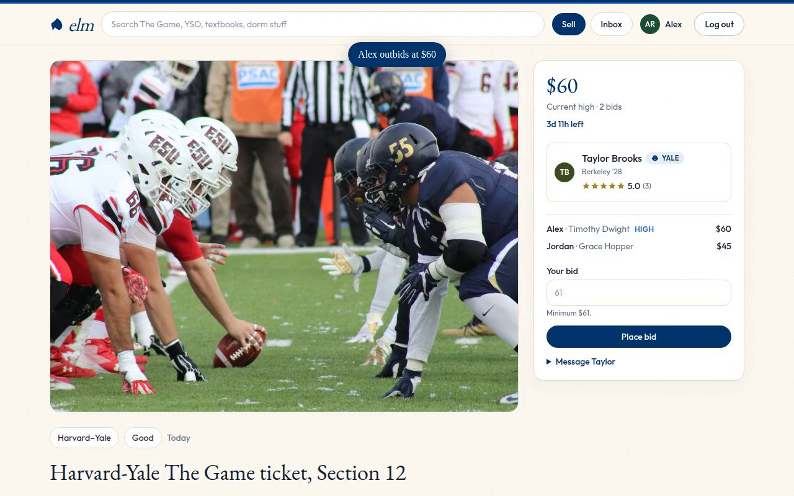
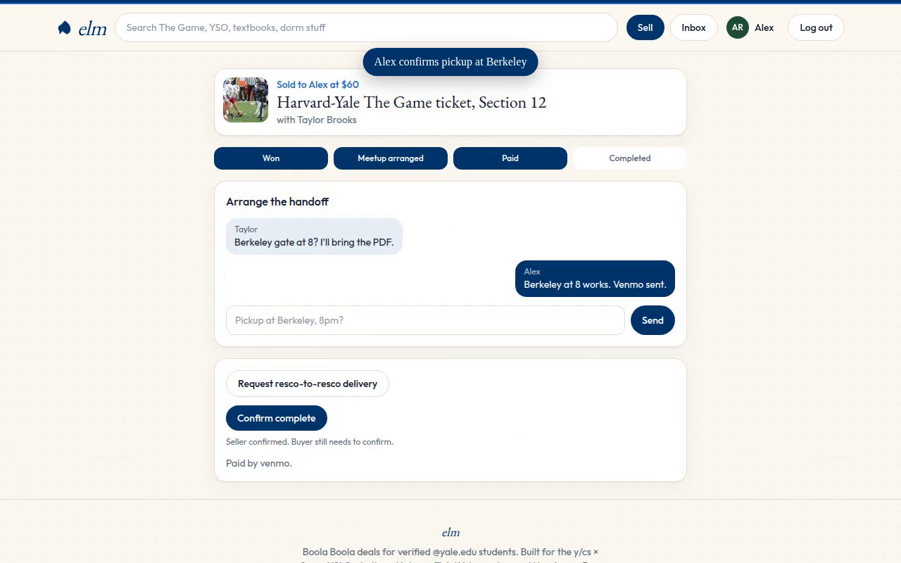
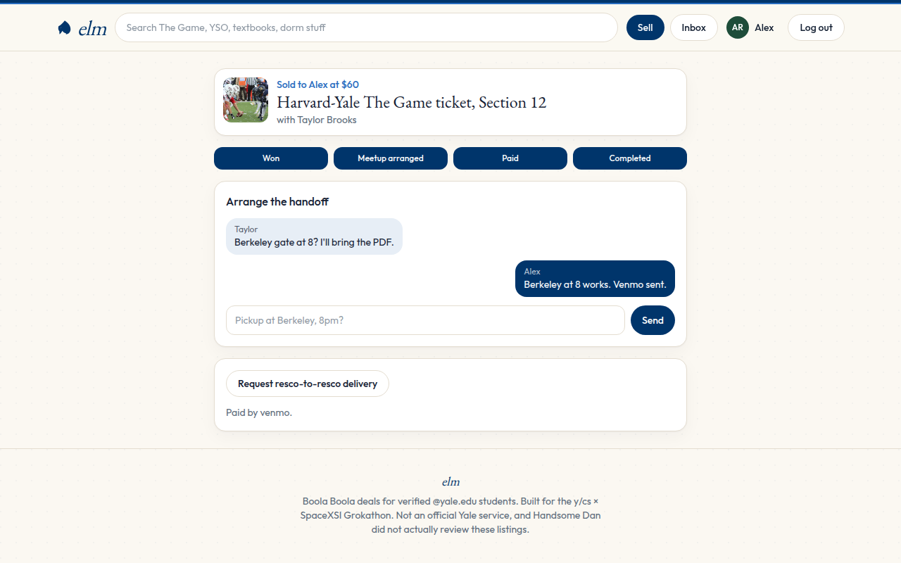
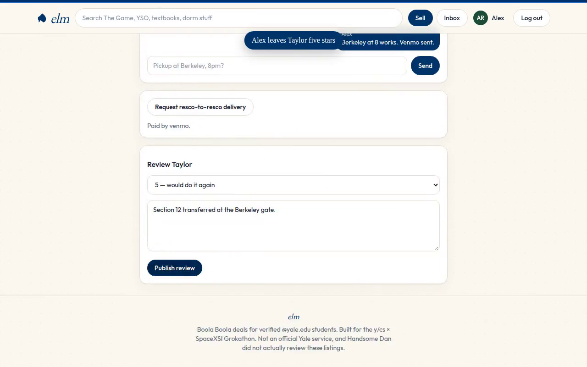
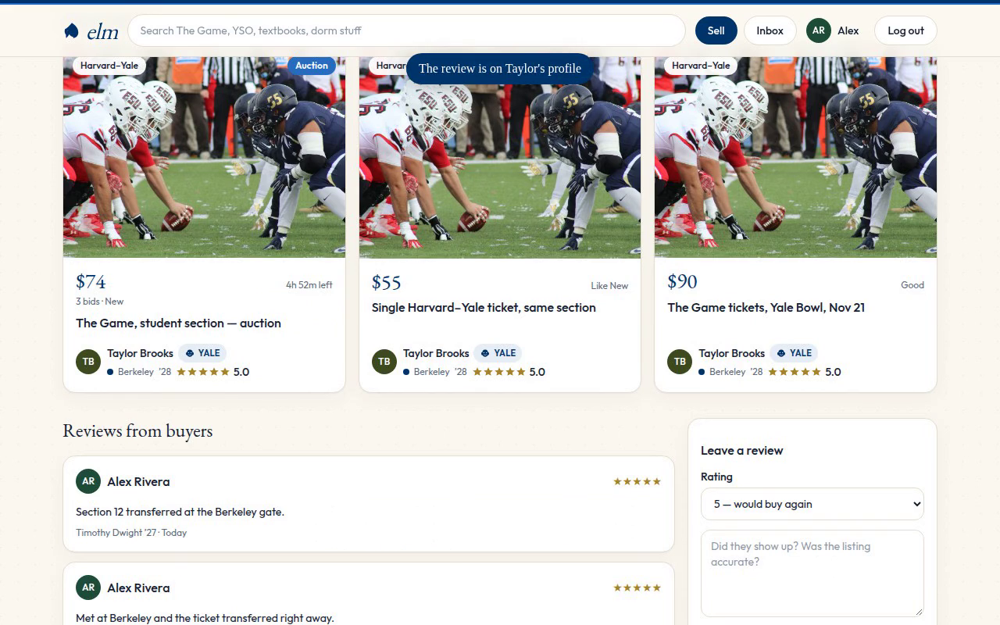

# Elm

A Yale-only student marketplace. Every account is an `@yale.edu` email, and every listing shows the seller’s residential college, a verified Yale badge, and ratings from people who actually bought from them.

Students use it for The Game and YSO tickets, textbooks, and the dorm things that are awkward to sell on Facebook Marketplace or an anonymous app. When an auction ends, the high bidder and the seller get a handoff thread to set a meetup, mark the payment, and leave reviews.

## Run it

```bash
npm install && npm run dev
```

Open [http://localhost:3847](http://localhost:3847).

The first `npm run dev` creates the SQLite database and loads the demo listings. Later runs leave your accounts and new listings in place.

Reset the demo data:

```bash
npm run db:reset
```

## Demo login

| | |
| --- | --- |
| Email | `jordan.park@yale.edu` |
| Password | `yaleblue` |

Jordan (Grace Hopper ’28) already has offer threads with Maya Chen and Taylor Brooks. Every seeded account uses the password `yaleblue`. Other useful logins: `taylor.brooks@yale.edu` and `alex.rivera@yale.edu`.

Sign-up rejects anything that isn’t an `@yale.edu` address.

## Features

- Accounts are limited to `@yale.edu`. Each profile has a name, class year, and one of Yale’s 14 residential colleges.
- Browse, search, and filter listings by category (Tickets, including YSO and The Game, plus Furniture, Textbooks, Electronics, Clothing, and Other), college, condition, price, and auctions.
- Post a fixed price or an auction with a starting bid and an end time. Buyers place bids that have to beat the current high.
- The seller can end an auction early. It also closes when the clock runs out. The high bidder wins, and the listing shows who bought it and for how much.
- Winner and seller get a handoff page: chat to set a meetup, optional resco-to-resco delivery, then mark paid (Venmo or cash) and confirm completion.
- After the handoff, each side can leave a star rating and a written review. Those reviews show on the profile and change the average.
- Message a seller about a fixed-price listing and attach an offer.

## Demo

[Watch the 70-second demo](docs/demo.mp4)

| Bidding | Meetup chat | Completed |
|---|---|---|
|  |  |  |

| Writing a review | Seller profile |
|---|---|
|  |  |
